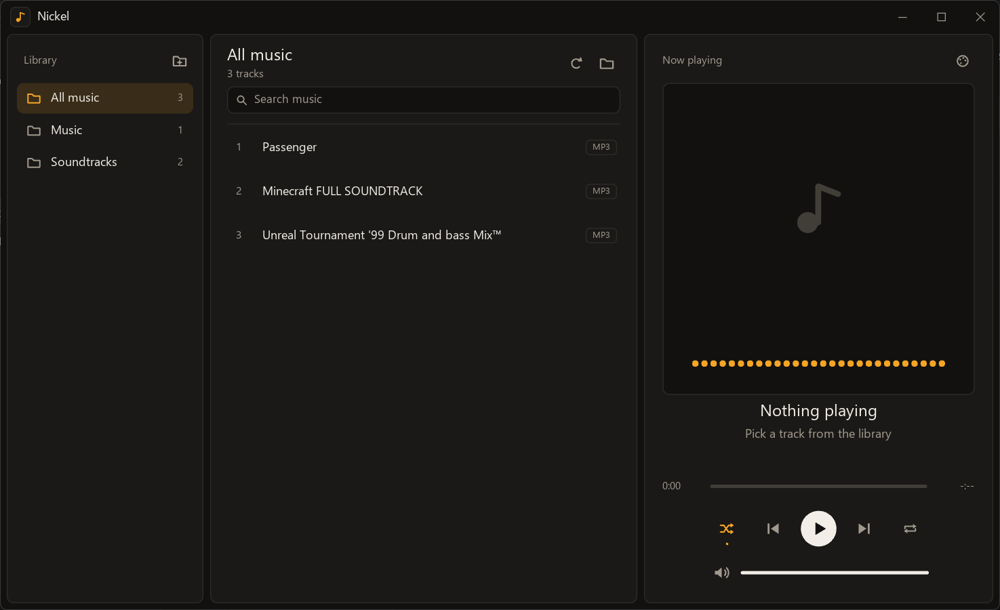

# Nickel

A small, native music player for Windows, written in [Jai](https://jai.community/).



Nickel builds to a single self-contained `.exe`: Direct3D 11 rendering with a custom title bar,
FreeType, stb_vorbis and stb_image linked in statically, and everything else (MP3, FLAC, AAC, WMA, ...) decoded
by Windows' own Media Foundation codecs. It only depends on DLLs that ship with Windows 10/11.

## Features

- Scans your Music folder in the background; every sub-folder becomes a sidebar entry. Extra folders can be added.
- Reads ID3 tags for title / artist / album.
- Shows cover art embedded in MP3 (ID3), FLAC, M4A and Ogg files, or a `cover.jpg` / `folder.jpg` next to the track.
- Plays `.mp3`, `.flac`, `.ogg`, `.wav`, `.m4a`, `.aac`, `.wma`.
- Drag and drop files or folders onto the window, or pass them on the command line.
- Registers itself for its audio types, so it shows up under "Open with" and in Settings > Default apps
  (the check-mark button next to the color scheme button opens that page). Opening more files while
  Nickel is running sends them to the open window.
- Search, shuffle, repeat, four color schemes.
- Global media keys work while the window is in the background.
- Settings are saved to `%APPDATA%\Nickel\settings.txt`.

## Keyboard shortcuts

| Key               | Action                 |
|-------------------|------------------------|
| Space             | Play / pause           |
| X                 | Stop                   |
| Left / Right      | Seek -5 s / +5 s       |
| Ctrl+Left / Right | Previous / next track  |
| Up / Down         | Volume up / down       |
| M                 | Mute                   |
| S                 | Toggle shuffle         |
| R                 | Toggle repeat          |
| O                 | Open files             |
| Ctrl+F            | Search                 |
| Esc               | Clear search           |
| F5                | Rescan library         |

## Building

Requirements: the Jai compiler, Visual Studio (MSVC linker), and the Windows SDK.

```
jai build.jai              # debug build   -> nickel.exe
jai build.jai - release    # release build -> release/nickel.exe
```

The release build is fully optimized with runtime checks (bounds, null, cast) turned off, and still
writes a `.pdb` next to the exe for debugging crashes. Both builds link the Visual C++ runtime
statically and embed `nickel.ico`. (`jai main.jai` also works, but the result depends on
`vcruntime140.dll`.)

Run it with optional files or folders to open:

```
nickel.exe [files or folders...]
```

Nickel registers its file types under `HKEY_CURRENT_USER` each time it starts (no admin rights
needed). To remove that registration again:

```
nickel.exe --unregister
```

### Shaders

`shader.hlsl` is precompiled into `shaders/*.cso`, which are checked in and
embedded into the exe at compile time. After editing the shader, regenerate them with:

```
jai tools/compile_shaders.jai
```

## Project layout

| File                       | Contents                                          |
|----------------------------|---------------------------------------------------|
| `main.jai`                 | Window, input, UI, settings                       |
| `gfx.jai`                  | Direct3D 11 renderer and FreeType text            |
| `audio.jai`                | Streaming decode (Media Foundation, stb_vorbis) and waveOut playback |
| `library.jai`              | Music folder scanning and tag reading             |
| `art.jai`                  | Cover art extraction and decoding (worker thread) |
| `shell.jai`                | File associations and single-instance handoff     |
| `build.jai`                | Build script (static CRT link, icon embedding)    |
| `shader.hlsl`, `shaders/`  | Shader source and precompiled bytecode            |
| `tools/compile_shaders.jai`| Shader compiler script                            |

## License

[MIT](LICENSE). Nickel statically links [FreeType](https://freetype.org/) (FreeType License) and
[stb_vorbis and stb_image](https://github.com/nothings/stb) (public domain / MIT).
